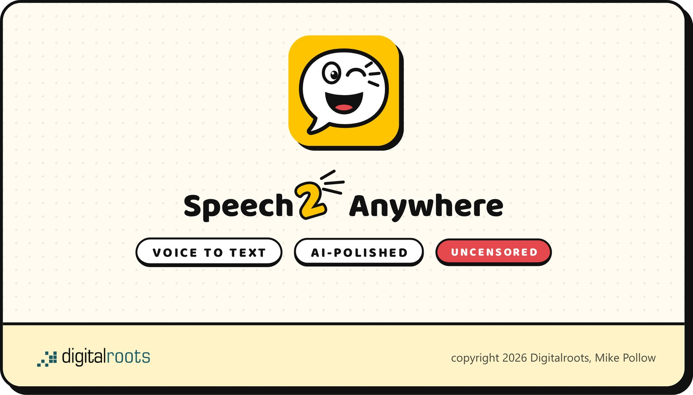
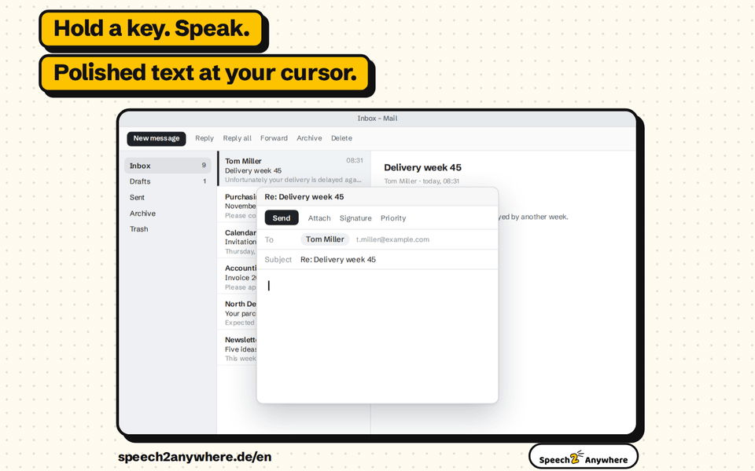

# Speech2Anywhere

**You hold a key, you talk and release, and the local AI converts your speech into a beautiful text at the cursor.**

Speech2Anywhere connects your voice to all Windows programs like email, chat, Word, web browser, terminal, code editor. You hold a key and as you speak you keep it pressed. When you release the key, a language model on your PC converts your speech into a clean text at the cursor position. If you're in a specialized area, you can enable vocabulary for medicine, law, IT or one of four other categories. That way, technical terms are also correct much more often. Everything runs without the cloud, without an account, without a subscription.

Website with all features: [speech2anywhere.de](https://speech2anywhere.de/en/), also in [German](https://speech2anywhere.de/).

## What it does

* Works in all programs: the text lands at the text cursor, no matter which program, with no program plugin and no copy and paste. Everything that was on the clipboard before (images, files, formatted text) is there again afterwards.

* The local AI does more than just transcription: your speech is converted into text with Whisper and then it's supplemented with punctuation, removal of filler words, slip-of-tongue correction using a local AI model in Ollama. That way, "on Tuesday, no, on Friday" becomes "on Friday". Furthermore, the text is adapted to the program in which you write it. So mail looks like mail. And your prompt in the terminal looks exactly like you said it.

* Specialized vocabulary: on its own settings tab you can activate vocabulary for medicine, medications, law, business, science/engineering, chemistry, IT. Then, the cleanup is aware of the field and has up to five similar-sounding words for each dictation. So a wrongly heard "lefotyruxin" turns into "Levothyroxin". (In a test with 60 invented specialist dictations in German & English, 1 of 133 terms was wrong with an activated field, 8 without. For everyday dictations, nothing changed.)

* Editing texts with your voice: you select text, hold F9 and say what to change (e.g. "make it friendlier") and then the text is edited directly.

* Everything stays on your PC. The audio and text don't leave your computer. Only for updates and downloading models, Speech2Anywhere connects to the internet.

Also included:

* 8 languages (or automatic detection) for dictation (German, English, French, Italian, Dutch, Polish, Portuguese, Spanish). The cleanup answers in the language that was spoken. German and English in the user interface.

* Speech2Anywhere works with an NVIDIA graphics card or, if not available, with the processor. The wizard for the first start will measure your PC and suggest what's better.

* You can either keep the key pressed while speaking or tap it once for start and once for stop.

* It converts audio/video files to a text file with .srt subtitles.

* It learns from your corrections to German dictations before sending.

* Any model from Ollama can be the cleanup model. This includes GGUF models from Hugging Face.

* 18 styles for the live indicator at the cursor, with optional sounds.

## Two builds, one idea

| | Windows 11 (this repository) | macOS (Mac App Store, separate code base) |
|---|---|---|
| Hotkey | hold **F8** or tap it in toggle mode, **F9** for AI edit commands | hold **fn** (Globe key) |
| Speech to text | faster-whisper, `large-v3` on CUDA or `small` on the processor | Whisper `large-v3-turbo`, runs on the Mac |
| Text cleanup | Ollama, `gemma4:12b`, or `gemma4:e4b` with little video memory and on the processor, uncensored model optional | Qwen3 8B, runs on the Mac, no Ollama needed |
| Hardware | NVIDIA GPU with about 10 GB of free video memory (14 GB for `gemma4:12b`), or the processor | Apple silicon, macOS 15 or later, about 6.3 GB of free disk space for the two models |
| Install | installer on the [Releases page](https://github.com/MikeGT4/speech2anywhere/releases/latest) | coming soon to the Mac App Store, see the [website](https://speech2anywhere.de/en/) |

## Requirements

- Windows 11 (Windows 10 should work, untested)
- An NVIDIA GPU with about 10 GB of free video memory (about 14 GB for `gemma4:12b`), or no graphics card: then Speech2Anywhere runs on the processor. That is slower and works best with 12 GB of RAM or more
- 25 GB of free disk space: the installer is about 3.5 GB, the first-run wizard pulls 10 to 13 GB of models into `%USERPROFILE%\models\` and `%USERPROFILE%\.ollama\`
- A stable internet connection for the first start (one-time model download)

## Install (end users)

The installer needs all files of the [latest release](https://github.com/MikeGT4/speech2anywhere/releases/latest) in one folder: `Kira-Setup-vX.Y.Z.exe`, the `.bin` parts (`-1.bin`, `-2.bin`) and `SHA256SUMS.txt`. The setup is split into parts, so the `.bin` files must sit next to the `.exe`. The file `kira-X.Y.Z-py3-none-any.whl` is the program package for in-app updates; a fresh install does not need it.

1. Double-click `Kira-Setup-vX.Y.Z.exe`.
2. If Windows Defender SmartScreen warns: "More info", then "Run anyway". Speech2Anywhere is not code-signed. Verify the download with `certutil -hashfile Kira-Setup-vX.Y.Z.exe SHA256` against `SHA256SUMS.txt` if you want to be sure.
3. Click through the setup wizard.
4. On first start a second wizard measures your PC, recommends graphics card or processor and downloads the matching models (10 to 13 GB from Hugging Face and the Ollama registry). One time only; dictation works offline afterwards.
5. Speech2Anywhere starts in the tray with a yellow framed logo. **Hold F8, speak, release.**

Later updates run from the tray menu. When a new version is out, the tray icon shows a green mark with an arrow; its tooltip gives the version. If only the program changed since your version, Speech2Anywhere loads just the program package (about 6 MB), checks its SHA-256 and restarts itself; otherwise it loads the full setup.

### Installation (Deutsch)

Für die Installation kommen alle Dateien der [neuesten Release](https://github.com/MikeGT4/speech2anywhere/releases/latest) in denselben Ordner: `Kira-Setup-vX.Y.Z.exe`, die `.bin`-Teile und `SHA256SUMS.txt`. Die `.bin`-Teile müssen neben der `.exe` liegen; die Datei `kira-X.Y.Z-py3-none-any.whl` ist das Programmpaket für Updates aus der App und wird für eine neue Installation nicht gebraucht. Danach startest du die `.exe` mit einem Doppelklick. Zeigt SmartScreen eine Warnung, geht es über „Weitere Informationen“ und „Trotzdem ausführen“ weiter, weil Speech2Anywhere nicht signiert ist. Beim ersten Start misst ein zweiter Assistent deinen Rechner, empfiehlt Grafikkarte oder Prozessor und lädt die passenden Modelle, danach funktioniert das Diktieren auch ohne Internet. Speech2Anywhere erscheint dann in der Taskleiste, und zum Diktieren hältst du F8, sprichst und lässt die Taste wieder los.

## Developers

The guide in [DEVELOPERS.md](DEVELOPERS.md) covers installing from source, the configuration, learning from corrections and troubleshooting.

## License

Speech2Anywhere is licensed for personal use, and the terms are in [`LICENSE`](LICENSE) in English and German. Commercial use needs written consent.

The word lists `assets/wordlist-*.txt` are derived from [wordfreq](https://github.com/rspeer/wordfreq) data, licensed under [CC BY-SA 4.0](https://creativecommons.org/licenses/by-sa/4.0/).

Made by [Digitalroots](https://www.digitalroots.de/en/leistungen/assistenten/speech2anywhere/), Mike Pollow.
